<p align="center">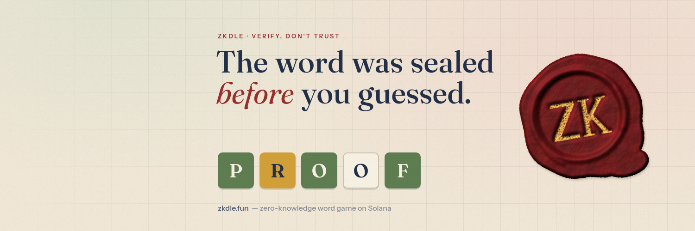</p>

# ZKdle

A five-letter word game on Solana where **every clue is proven**. The answer is committed on-chain as `Poseidon(word, salt)` before anyone plays. Each green, yellow and gray comes with a Groth16 proof, and the Solana program checks that proof against the commitment before it records the row.

Full rules with every number: **[zkdle.fun/docs](https://zkdle.fun/docs)**.

<p>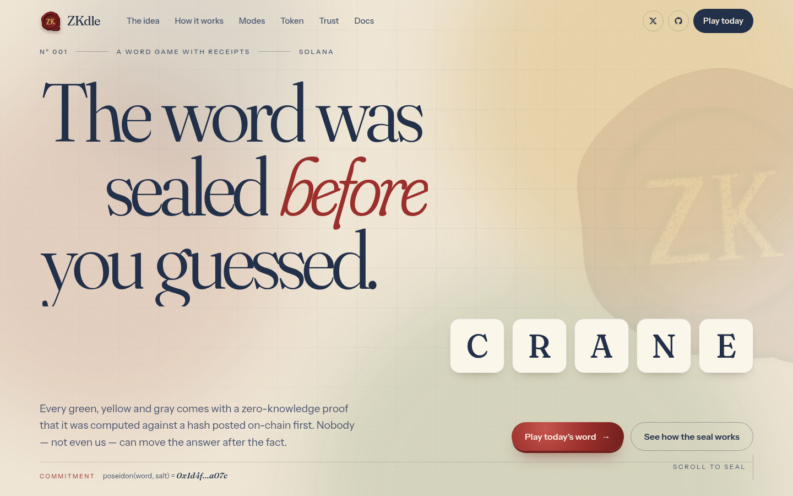 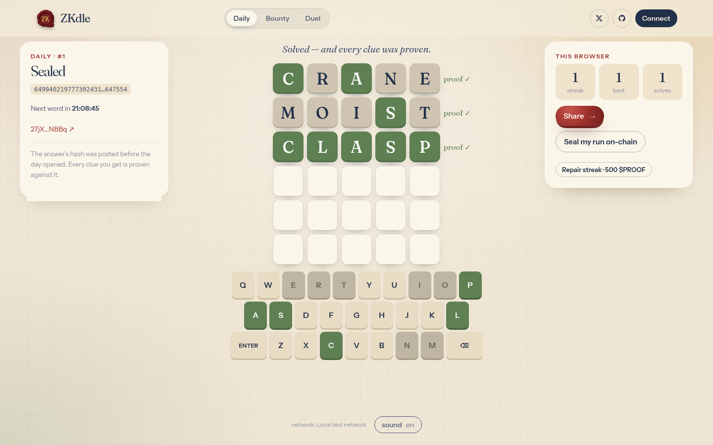</p>

<p align="center">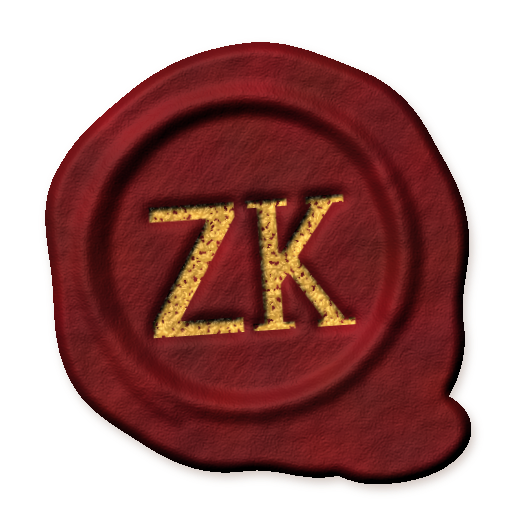 &nbsp; </p>

> **Status: early access.** The production site runs in **preview mode** until mainnet launch: the landing page and [/docs](https://zkdle.fun/docs) are live, while games show “Opening soon” and no keys or RPC are loaded. `ZK_PREVIEW` unset or `1` = preview, `ZK_PREVIEW=0` = full game.

## How it works

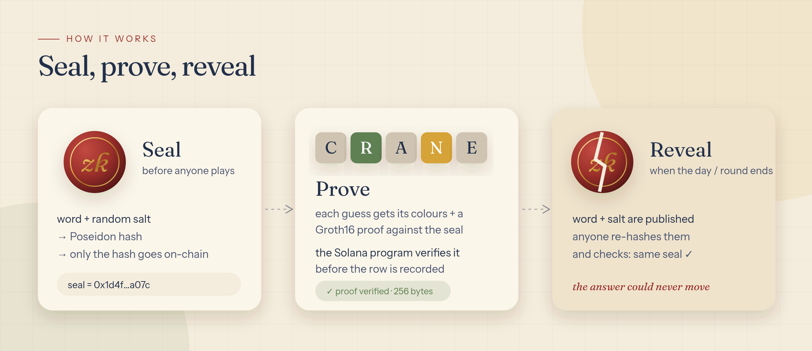

1. **Seal.** Word + random salt → Poseidon hash. Only the hash goes on-chain.
2. **Prove.** Every guess gets its colours plus a 256-byte Groth16 proof. The program verifies it against the seal before recording the row.
3. **Reveal.** When the day or round ends, the word and salt (or the round seed) are published, so anyone can re-hash them and check.

## Modes

### The Daily


- One word for everyone, six tries. Free, and no wallet needed (sealing a run on-chain costs only Solana fees and account rent).
- Proofs are checked in the browser. “Seal my run” puts every row on-chain, and your streak lives in your own PDA.
- New word at 00:00 UTC. Yesterday’s word and salt are published.
- Streak repair: burn 500 $PROOF to bridge exactly one missed day.

### Bounty rounds (paid in $PROOF)

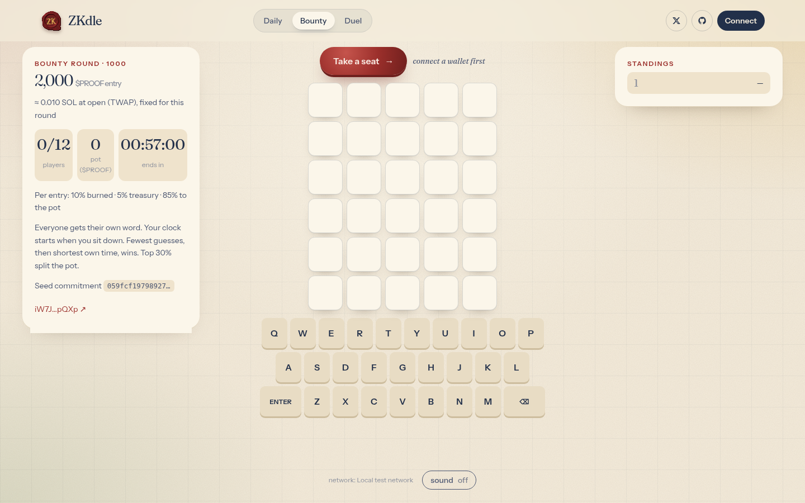

| | |
|---|---|
| Round length | 1 hour; the next round opens as the previous one closes |
| Seats | **12 per round during early access** (enforced by the program), one per wallet per round |
| Entry | the $PROOF worth **0.01 SOL** (`ZK_ROUND_ENTRY_SOL`), fixed once when the round opens and stored on-chain |
| Per entry | **10% burned** (SPL BurnChecked) · **5% treasury** · **85% escrowed** in a token account owned by the round PDA |
| Paid places | top 30% of seats, rounded up; exact ties go to the earlier seat |
| Ranking | fewer guesses, then shorter **own** time |
| No solver | each seat gets its escrowed 85% back |
| Last call | no new seats in the final 2 minutes; warning when < 10 minutes are left |

**Fairness: no first-mover advantage**

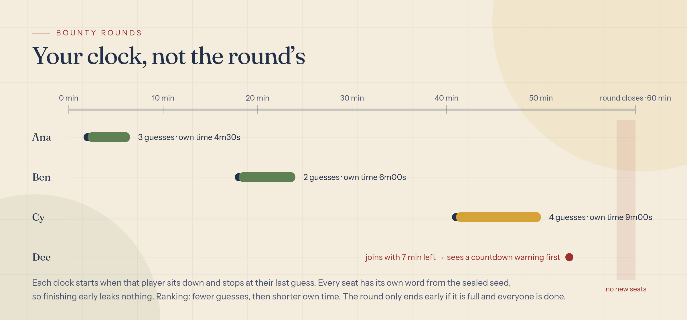

- Your clock starts when **you** sit down and stops at your last guess, so joining late costs nothing.
- Every seat has a **different word**, derived from a seed committed before the round opened. Finishers can’t leak your answer.
- Solving first doesn’t end the round. It ends early only when it is full **and** every board is finished.
- Late joiners get a countdown warning. Seats close 2 minutes before the end, and unfinished boards at the close count as unsolved.
- The server issues six proofs per seat, no more.

**Where an entry goes**

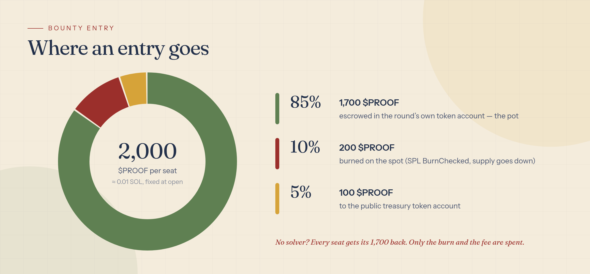

**Price.** At open, the server samples $PROOF’s on-chain reserves: the pump.fun bonding curve before graduation, then the pool’s reserve accounts (`ZK_PRICE_POOL_VAULTS`, PumpSwap or Raydium). It uses the **median over about 5 minutes**, clamped by `ZK_ROUND_ENTRY_MIN_TOKENS` / `MAX_TOKENS`. If no price is available, it falls back to `ZK_ROUND_ENTRY_TOKENS` (1,000). The UI shows the entry in $PROOF plus its ≈SOL value at open.

**Payouts**

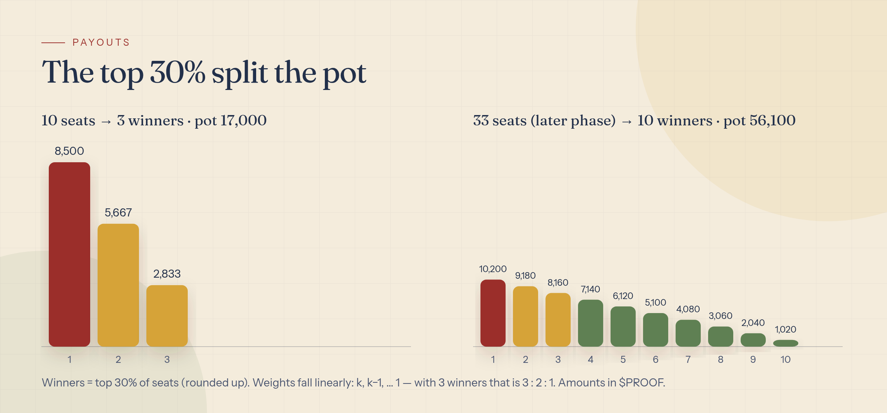

Weights fall linearly: *k*, *k*−1, … 1, and first place also gets the rounding dust. Worked examples with a 2,000 $PROOF entry (1,700 to the pot per seat):

| Seats | Winners | Pot | 1st | 2nd | 3rd | 4th |
|---|---|---|---|---|---|---|
| 4 | 2 | 6,800 | 4,533 | 2,267 | — | — |
| 10 | 3 | 17,000 | 8,500 | 5,667 | 2,833 | — |
| 12 | 4 | 20,400 | 8,160 | 6,120 | 4,080 | 2,040 |
| 33 (later phase) | 10 | 56,100 | 10,200 | 9,180 | 8,160 | … 1,020 |

Settlement is one permissionless instruction. Afterwards every card account is closed (`close_card`) and its rent goes back to the player.

### Duels (SOL)

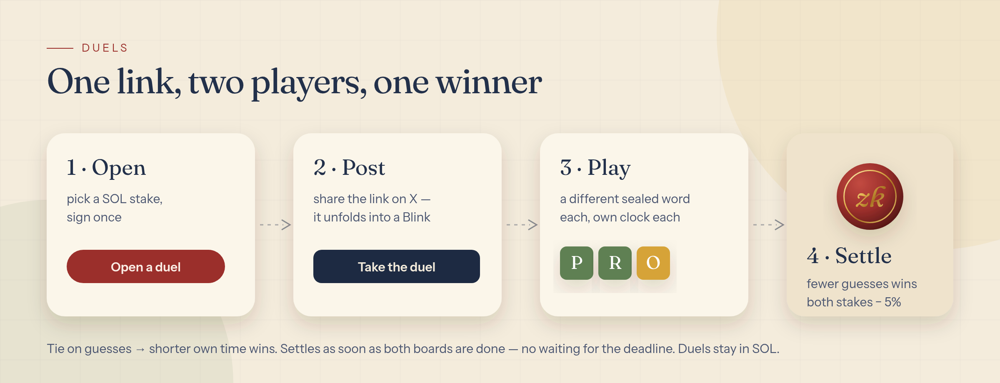

- Two players, equal SOL stakes, and a different sealed word each. The link unfolds into a “Take the duel” Blink on X.
- Fewer guesses wins; a tie goes to the shorter own time. The winner takes both stakes minus the 5% fee.
- Stake 0.005 to 100 SOL. Open for up to 24 h.
- Settles as soon as both boards are finished. If nobody accepts, or neither side solves, both stakes are refunded in full with no fee.

## Early access: capacity roadmap

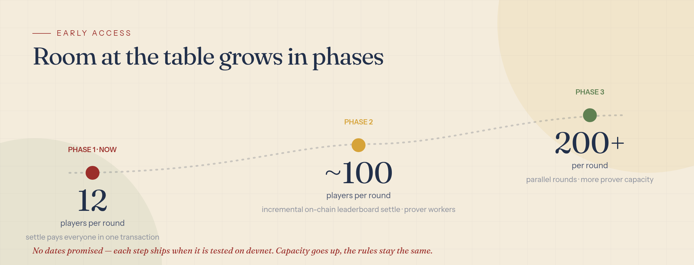

Bounty rounds start at **12 players per round** while we test in public. That is what one settle transaction pays out comfortably today (measured on a local validator: [`docs/capacity.txt`](docs/capacity.txt)). Capacity goes up in phases as the upgrades ship, with no dates promised:

- **Phase 1 (now):** 12 per round.
- **Phase 2:** about 100 per round, with an incremental on-chain leaderboard (settlement no longer needs every seat in one transaction) and dedicated prover workers.
- **Phase 3:** 200+ per round, with parallel rounds.

Proofs run single-threaded through a global queue (`ZK_PROVE_CONCURRENCY`, default 1). When more than 30 are waiting the API answers 429 and clients retry with backoff.

## $PROOF

- **Bounty entries:** 10% of every entry is burned.
- **Streak repair:** burn 500 $PROOF.
- **Holder frame:** wallets with ≥ 100,000 $PROOF get a gold frame and a Pf holder badge on share cards.
- **Treasury:** 5% of each entry goes to a public treasury token account.

`ZK_TOKEN_MINT` empty → the site says “not launched yet” and bounty shows “opens at token launch”.

## Trust model (honest version)

Enforced by the program: clues match the sealed word. Burn, fee, escrow, payout order, the 30% cut and refunds are computed on-chain. The fee is capped at 20% (set to 5%) and payable only to the configured treasury; the burn is capped at 50% (set to 10%). Round seeds must match their commitment. Rounds are capped at 12 seats.

Still trusted: the server knows the answers (it builds the proofs) and could leak them. It rations proofs and co-signs seats. It picks the words and seeds (commitments stop later changes, not choice). The entry price is a server-side TWAP within clamps. The phase-2 setup was three team contributions plus a public beacon (see below).

## Security & trust

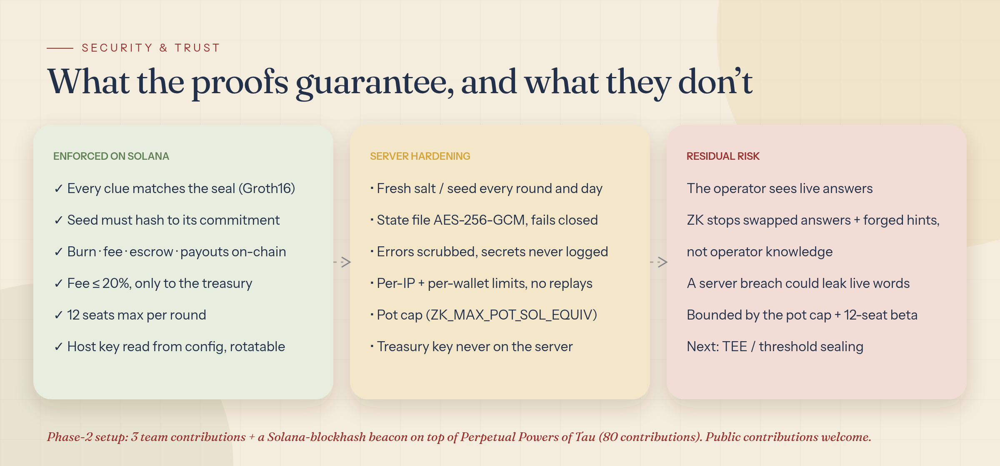

**Server hardening**
- Fresh random salt every day and a fresh 32-byte seed every round/duel, committed on-chain before entry.
- The state file (live answers, salts, seeds) is AES-256-GCM encrypted with `ZK_SECRET_KEY` (32 bytes, hex or base64). Outside localnet the server won't start without it.
- No endpoint, share card or error leaks a live secret. Unexpected errors become `server error (id)` and log lines are scrubbed. An e2e test checks every public response.
- Per-IP and per-wallet rate limits (`ZK_WALLET_PER_MIN`, default 20). Six proofs per seat, no repeated guesses, nothing after end or reveal.
- `ZK_MAX_POT_SOL_EQUIV` (default 5) caps a round's escrow. Further seats are refused.
- The host key only co-signs and opens/reveals. The treasury is an address; its key is never on the server.

**Rent reclaim.** After settle, the server closes every seat card (rent back to the player) and then the round with `close_round` (op 11): escrow token account and round rent go back to whoever opened it. `close_round` needs the round settled, the escrow empty, and every card closed, or 24 h after the end; leftover cards stay closable by anyone, rent to their player.

**Host key rotation.** The program reads the host from the config PDA. `set_admin` (op 10) needs both the current and the new key to sign:
1. Generate the new key offline.
2. Send `setAdmin(old, new)` signed by both.
3. Check that config bytes 1..33 hold the new key.
4. Restart the server with the new `ZK_HOST_KEY`.
5. Retire the old key.

**Trusted setup.** Phase 1: PSE Perpetual Powers of Tau (`ppot_0080_10.ptau`, 80 contributions). Phase 2: three contributions plus a beacon from the blockhash of Solana mainnet slot 458674048, which was committed to before the contributions. Transcript, hashes and `snarkjs zkey verify` output: [`docs/ceremony/`](docs/ceremony/). **All three phase-2 contributions were made by the ZKdle team.** Public contributions are welcome and a public round will open.

**Residual risks**
- The operator sees live answers. ZK prevents swapped answers and forged hints, not operator knowledge.
- A server compromise could leak live answers for open rounds. The pot cap and the 12-seat beta limit what that is worth.
- Daily proofs aren't bound to a wallet (they're replayable; the Daily is free). Round and duel seats have per-seat seals.
- Future path: sealing in a TEE or with threshold keys.

## Public wallets (mainnet)

| Role | Address | What it does |
|---|---|---|
| Treasury | [`FuRUWehSQyB8EaMy5t8SRmYhKZEc8cBpYWBXripikXW6`](https://solscan.io/account/FuRUWehSQyB8EaMy5t8SRmYhKZEc8cBpYWBXripikXW6) | Receives the 5% fee from bounty entries (and duel payouts). Key never on the server. |
| Host | [`FYY8DXRz2ZvirwQxJqgkfrjftDH3Bsfpn9AyQwm5evvU`](https://solscan.io/account/FYY8DXRz2ZvirwQxJqgkfrjftDH3Bsfpn9AyQwm5evvU) | Server signer: opens/settles rounds, co-signs seats, pays fees and reclaimable rent. Rotatable via `set_admin`. |
| Deployer | [`A79M6eVude5szKrAX1M9ppRkti7Bx6P1evyYeFKWJe4Z`](https://solscan.io/account/A79M6eVude5szKrAX1M9ppRkti7Bx6P1evyYeFKWJe4Z) | Deploys the program; upgrade authority until it moves to a multisig. |
| Program (mainnet) | [`4fCcuHmPEfyVu8AtEWE1CtFoLyUrh8S58SS471JDGLtu`](https://solscan.io/account/4fCcuHmPEfyVu8AtEWE1CtFoLyUrh8S58SS471JDGLtu) | The ZKdle program (verified build). Config PDA [`J2sB…bgd6`](https://solscan.io/account/J2sBh74Fma5NBEeqwdsJKLcSswqsVM36DjFfLpnSbgd6) (host, treasury, 5% fee). |
| $PROOF mint | added at token launch | |

**Verified build.** The mainnet program is built reproducibly with [`solana-verify`](https://github.com/Ellipsis-Labs/solana-verifiable-build) (Docker image for Solana 4.3.0, pinned in `program/Cargo.toml`) and verified against this repository by OtterSec: [verification status](https://verify.osec.io/status/4fCcuHmPEfyVu8AtEWE1CtFoLyUrh8S58SS471JDGLtu) · [Solscan](https://solscan.io/account/4fCcuHmPEfyVu8AtEWE1CtFoLyUrh8S58SS471JDGLtu#security). To check it yourself: `solana-verify verify-from-repo -um --program-id 4fCcuHmPEfyVu8AtEWE1CtFoLyUrh8S58SS471JDGLtu https://github.com/zkdle/zkdle --commit-hash 5a452854b9f4b92e42c0fc31b25ece480979da79 --library-name zkdle --mount-path program --base-image solanafoundation/solana-verifiable-build@sha256:12fd4c0a0790f0fc41ef74b0cdb6bccc167ba6137eb1adb749bac649481c86bd`. Expected executable hash: `05321b14713ba2c9c02ce89095d63a70d47e9540342ce0162625b67866dd7316`. The program also carries a `security.txt` (contacts and the [security policy](SECURITY.md)).

**Upgrade authority.** The program is upgradeable. The upgrade authority is currently the deployer wallet `A79M…e4Z` above; the plan is to move it to a Squads multisig once early access settles. Any upgrade is public on-chain and would show as unverified until it is re-verified against a commit here.

## How it fits together

```
circuits/clue.circom   Clue logic (adapted from alxkzmn/zk-wordle) + Poseidon(packed word, salt) == seal
zk/                    circuit, proving + verifying key, JS helpers (queued single-thread prover)
program/               native Solana program: groth16-solana verifier, SPL Token CPI (burn / escrow / PDA-signed payouts)
lib/                   instruction builders, account readers, SPL helpers, price TWAP, word lists, share cards
server.js              Express: proven clues, host co-signing, rounds, /api/rpc proxy, Actions, OG cards
src/ → public/         landing, game and docs pages (esbuild bundles)
scripts/diagrams.js    the diagrams in docs/img
```

## Run it

```bash
npm install
npm run build            # bundles + brand assets
npm run build:program    # needs Solana platform tools (cargo-build-sbf)
npm run e2e              # local validator, full game flows incl. a 12-seat $PROOF round
npm run localnet         # playground on http://127.0.0.1:5290 (test network, mock $PROOF + pool)
npm start                # preview by default; ZK_PREVIEW=0 + .env (see .env.example) for the full game
```

Test results: **[`docs/test-report.md`](docs/test-report.md)** (all suites, the security tests, and a devnet run with explorer links). Raw lists: [`docs/e2e-results.txt`](docs/e2e-results.txt), [`docs/capacity.txt`](docs/capacity.txt).

Credits: clue circuit logic adapted from [alxkzmn/zk-wordle](https://github.com/alxkzmn/zk-wordle); verifier from [Lightprotocol/groth16-solana](https://github.com/Lightprotocol/groth16-solana). Fonts: Fraunces, Instrument Sans (site), Gloock, Figtree, Kalam (brand images), all OFL.

MIT licensed.
